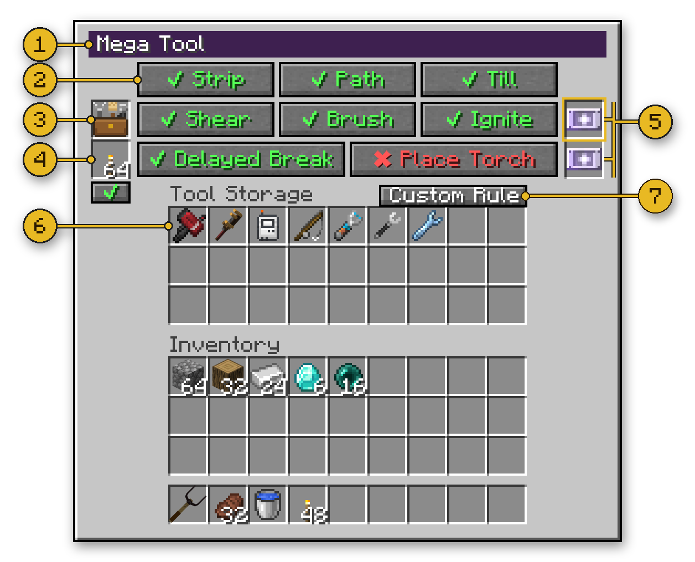
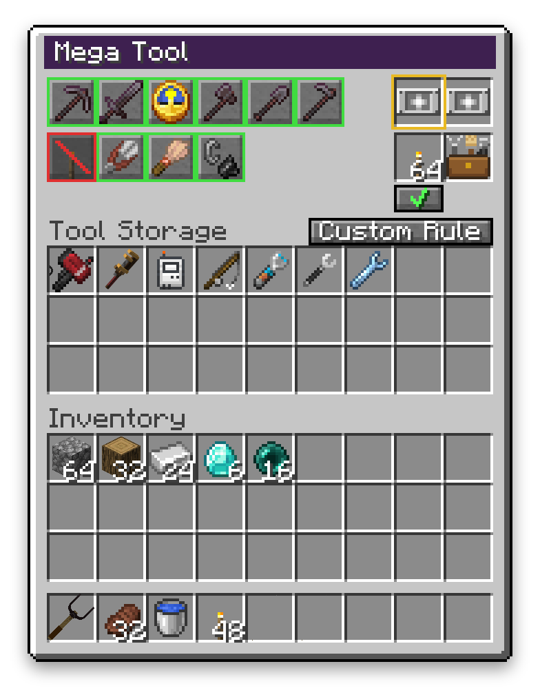
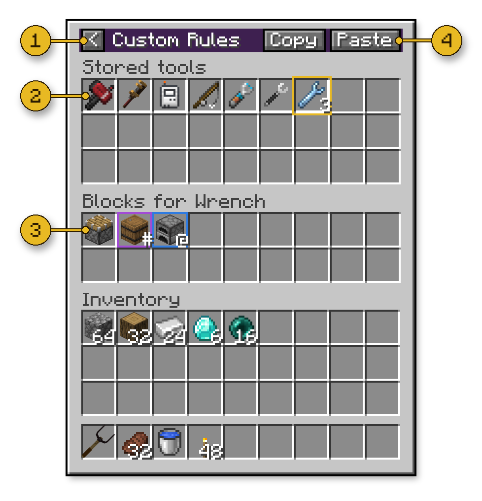

<p align="center">
  
</p>

<p align="center">
  <b>Paxels and the Mega Tool</b>: a pickaxe, axe, shovel, hoe and sword in one item, with built-in storage for your
  other tools, swappable enchantments and a torch slot that lights your way.<br>
  <sub>Minecraft 1.20.1 · Forge</sub>
</p>

---

## Contents

- [Items](#items)
- [Crafting](#crafting)
- [Using the tools](#using-the-tools)
- [The Mega Tool](#the-mega-tool)
- [The tool menu](#the-tool-menu)
- [Support Tool](#support-tool)
- [Enchantment Plates](#enchantment-plates)
- [Torches and light](#torches-and-light)
- [Tool storage and auto-swap](#tool-storage-and-auto-swap)
- [Durability and repair](#durability-and-repair)
- [Controls](#controls)
- [Settings](#settings)
- [For modpack developers](#for-modpack-developers)

---

## Items

| | Item | What it does |
|:-:|---|---|
|  | **Stone Paxel** | Pickaxe, axe, shovel, hoe and sword in one. |
|  | **Iron Paxel** | Iron-tier paxel with 9 slots of tool storage. |
|  | **Diamond Paxel** | Diamond-tier paxel with 18 slots of tool storage. |
|  | **Mega Tool** | Breaks any block instantly, never wears out, 27 slots of tool storage. |
|    | **Iron, Diamond and Netherite Head** | Crafting parts for the paxels and the Mega Tool. |
|  | **Support Tool** | Shears, brush and flint and steel in one. Gives a tool those abilities. |
|  | **Enchantment Plate** | Carries enchantments. The loaded plate enchants your tool. |

### Tool tiers

| | Stone Paxel | Iron Paxel | Diamond Paxel | Mega Tool |
|---|:-:|:-:|:-:|:-:|
| **Mining** | 20% faster than a stone pickaxe | 20% faster than an iron pickaxe | 20% faster than a diamond pickaxe | **Instant**, every block drops |
| **Attack damage** | 10 | 14 | 18 | 22 |
| **Attack speed** | 1.6 | 2.0 | 2.5 | 3.0 |
| **Durability** | 655 | 1,616 | 8,171 | Unbreakable |
| **Tool storage** | – | 9 slots | 18 slots | 27 slots |

Every tool also has a **Support Tool slot**, **two Enchantment Plate slots** and a **torch slot** (up to 64 torches).

---

## Crafting

Recipes marked *shapeless* can be placed in any arrangement.

<table>
  <tr>
    <td align="center"><br><b>Stone Paxel</b> <i>(shapeless)</i><br>Stone sword, axe, pickaxe, shovel and hoe</td>
    <td align="center"><br><b>Support Tool</b> <i>(shapeless)</i><br>Flint and steel, brush and shears</td>
  </tr>
  <tr>
    <td align="center"><br><b>Iron Head</b> <i>(shapeless)</i><br>Iron sword, axe, pickaxe, shovel and hoe</td>
    <td align="center"><br><b>Iron Paxel</b><br>Iron Head, chest and leather</td>
  </tr>
  <tr>
    <td align="center"><br><b>Diamond Head</b> <i>(shapeless)</i><br>Diamond sword, axe, pickaxe, shovel and hoe</td>
    <td align="center"><br><b>Diamond Paxel</b><br>Diamond Head, chest and leather</td>
  </tr>
  <tr>
    <td align="center"><br><b>Netherite Head</b> <i>(shapeless)</i><br>Netherite sword, axe, pickaxe, shovel, hoe and a Nether Star</td>
    <td align="center"><br><b>Mega Tool</b><br>Netherite Head, chest and leather</td>
  </tr>
  <tr>
    <td align="center" colspan="2"><br><b>Enchantment Plate</b><br>A book surrounded by 8 iron ingots</td>
  </tr>
</table>

> [!NOTE]
> If a crafting recipe ever uses up one of these tools, everything stored in it (tools, plates, Support Tool and torches) is given back to you.

---

## Using the tools

**Mining.** A paxel mines everything a pickaxe, axe, shovel and hoe can mine, and cuts cobwebs like a sword. Blocks that need a better tier still drop nothing, just like with vanilla tools.

**Fighting.** Paxels hit like a sword, including sweeping attacks. See the [tool tiers](#tool-tiers) for damage.

**Right-click abilities.** Right-click a block to use them. Each one can be switched on or off in the [tool menu](#the-tool-menu).

| Ability | What it does |
|---|---|
| **Strip** | Strips logs and wood, scrapes and removes wax from copper. |
| **Path** | Turns grass and dirt into paths, puts out campfires. |
| **Till** | Turns grass and dirt into farmland. Sneak while right-clicking to till instead of making a path. |
| **Place Torch** | Places a torch from the tool's torch slot. *Off by default.* |
| **Shear / Brush / Ignite** | Shears, brush and flint and steel abilities. Need a [Support Tool](#support-tool). |

If more than one ability fits a block, the first one in the table is used.

#### Break and Attack

Every paxel and the Mega Tool has two more buttons in the [tool menu](#the-tool-menu), both on by default:

- **Break.** Switch it off and the tool breaks no blocks at all, in any game mode. In survival, left-click actions on blocks (such as taking items out of drawers) still work.
- **Attack.** Switch it off and the tool does not hit mobs or players, so it does no damage. Things you hit to pick up or remove (item frames, paintings, boats, minecarts, armor stands) can still be hit.

Right-click abilities, tool storage and auto-swap keep working either way, so a tool can be made safe to carry around a base or to use only as a wrench holder.

---

## The Mega Tool


- **Instant mining.** Breaks every block in one hit, and every block drops as if mined with the right tool. Unbreakable blocks such as bedrock stay unbreakable. Flying, swimming and other mods' mining speed changes make no difference.
- **Delayed Break.** While you **hold** left click, the Mega Tool pauses briefly between blocks so you don't dig further than you meant to. Every new click still breaks a block immediately. Switch it off in the tool menu to break as fast as you can aim. The pause length can be changed in the [settings](#settings).
- **Never wears out**, and it doesn't burn in fire or lava.

---

## The tool menu

Hold a paxel or the Mega Tool and press **Ctrl + R**.

<p align="center">
  
</p>

| | |
|:-:|---|
| **1** | **Name.** Click it to rename the tool, then press Enter. |
| **2** | **Ability buttons.** Green ✔ = on, red ✖ = off. Row 1: Break and Attack (see [Break and Attack](#break-and-attack)). Row 2: Strip, Path, Till. Row 3: Shear, Brush, Ignite (only shown while a Support Tool is in its slot). Last row: Delayed Break (Mega Tool only) and Place Torch. |
| **3** | **Support Tool slot.** Unlocks Shear, Brush and Ignite. |
| **4** | **Torch slot** (up to 64 torches). The small button below it switches the light on or off. |
| **5** | **Enchantment Plates.** Primary (top) and secondary (bottom). The gold frame marks the loaded plate. |
| **6** | **Tool storage.** Hover a stored tool and press **R** to close the menu and swap straight to it. |
| **7** | **Custom Rule.** Opens the [Custom Rules menu](#custom-rules) of this tool, where you choose which blocks pre-select which stored tool. Only on tools with tool storage. |

Shift-clicking an item in your inventory moves it to the right slot automatically. The tool stays in your hotbar while the menu is open, and its slot is locked.

### Classic or Compact

The menu comes in two styles that do exactly the same. The first time you open a tool menu you are shown both and pick one:

- **Classic** (above): a wide menu, every button with its name on it.
- **Compact**: as wide as a chest, every button an item icon. A green frame means on; a red frame with the icon dimmed and struck through means off. Hover a button to read its name and what it does. Shear, Brush and Ignite are greyed out until a Support Tool is in its slot.

<p align="center">
  
</p>

In the Compact menu the first row is Break, Attack, Delayed Break (Mega Tool only), Strip, Path and Till; the second row is Place Torch, Shear, Brush and Ignite. The four slots on the right are the two Enchantment Plates (top), the torch slot with its light button (bottom left) and the Support Tool slot (bottom right).

Your choice is saved for your game. Change it at any time with `menuStyle` in `config/megatools-common.toml` (`CLASSIC`, `ICONS`, or `ASK` to be asked again).

---

## Support Tool


Craft a Support Tool from a flint and steel, a brush and shears, and put it in a tool's **Support Tool slot**. The tool then gains three abilities, each with its own button in the menu:

- **Shear:** shear sheep, mooshrooms and snow golems; collect leaves and vines; trim cave vines, kelp and weeping or twisting vines so they stop growing. Leaves and wool also mine at shears speed.
- **Brush:** hold right click on suspicious sand or gravel.
- **Ignite:** light fires and nether portals, campfires, candles and TNT.

Taking the Support Tool out removes the abilities again. It works in every paxel and in the Mega Tool.

---

## Enchantment Plates


The tools themselves can't be enchanted. You enchant **plates** instead, and the plate loaded in a tool gives it its enchantments.

**Enchanting a plate**
- **Enchanting table:** put in a blank plate, just like a book.
- **Anvil:** a plate on the left, an enchanted book on the right. Matching levels combine (Efficiency IV + IV = V).

Plates only accept enchantments for swords, pickaxes, axes, shovels, hoes, shears, brushes and flint and steel. Enchantments that don't go together, such as Silk Touch and Fortune, can't be put on the same plate.

**Two plates per tool.** Every tool holds a primary and a secondary plate. Press **Alt + R** to switch between them, for example from a Silk Touch plate to a Fortune plate. The message above the hotbar shows which plate was loaded. Rename a plate in an anvil to see that name in the message.

> [!TIP]
> If something removes an enchantment from your tool, such as a disenchanting machine from another mod, the loaded plate loses it too.

---

## Torches and light

Put **torches** or **soul torches** in the torch slot (up to 64).

- **Light.** While you hold the tool in either hand, the area around you is lit like a torch at full brightness. The light follows you, and other players see it too. Use the small button under the torch slot to switch it off.
- **Place Torch.** Switch it on in the menu, then right-click a block to place a torch from the slot.
- **Shaders.** With an Iris shader pack that supports handheld light, the tool glows like a held torch and the shader lights your surroundings smoothly. Other players then don't see your light.
- **Dynamic lights mods.** With Sodium Dynamic Lights, LambDynamicLights or RyoamicLights installed, that mod lights the held tool and Mega Tools places no light for you. The light then follows that mod's own settings, and other players only see it if they have such a mod too.

---

## Tool storage and auto-swap

The Iron Paxel, Diamond Paxel and Mega Tool can store **9, 18 and 27** other tools: wrenches, shears, screwdrivers, crowbars, configurators, building gadgets, construction sticks and more. Each slot holds one tool. Only items known to be tools are accepted, so the storage can't be used as a backpack. Modpacks can add more (see [which items can be stored](#which-items-can-be-stored)). Paxels, the Mega Tool and Enchantment Plates can never be stored.

**Auto-swap**

<p align="center">
  
</p>

1. Look at a block from another mod. Stored tools from the **same mod** are pre-selected and shown next to your hotbar.
2. Press **R** to swap the paxel for the selected tool. Your paxel is kept safely inside it.
3. Press **R** again to swap back. The tool returns to its storage slot.

**Swap to the last tool.** Press **Shift + R** to swap to the tool you swapped to last time, no matter what block you are looking at. Press **R** or **Shift + R** to swap back to your paxel. The tool is found even if you moved it to another storage slot.

If several stored tools match, **Shift + scroll** picks between them. Vanilla blocks never pre-select a tool on their own, because the paxel already handles them. If a swapped-out tool breaks, your paxel is given back to you automatically.

### Custom rules

Auto-swap only knows that a tool belongs to the blocks of its own mod. Custom rules let you decide yourself which stored tool is pre-selected for which block: a wrench for every chest, shears for leaves, a Flint and Steel for one special block. They also work on vanilla blocks.

Open the [tool menu](#the-tool-menu) and click **Custom Rule** above the tool storage.

<p align="center">
  
</p>

| | |
|:-:|---|
| **1** | **Back.** Returns to the tool menu. |
| **2** | **Stored tools.** One cell for every kind of tool in the tool storage. Click a tool to select it (gold frame). The small number is how many filters it has. |
| **3** | **Filters** of the selected tool: up to 18 blocks. |
| **4** | **Copy** and **Paste.** Move all rules from one paxel or Mega Tool to another. |

**Setting up a rule**

1. **Select the stored tool** the rule is for (**2**).
2. **Give it a block.** Any of these fills the next free filter slot (**3**):
   - pick the block up from your inventory and click a filter slot,
   - Shift-click the block in your inventory,
   - drag the block from **JEI** or **EMI** onto a filter slot.

   Nothing is used up: the slot only remembers the block, and the item stays where it was.
3. **Choose what the filter matches.** Left-click a filled slot to go to the next option:

   | Option | Matches | Shown as |
   |---|---|---|
   | This block | only that block | plain slot |
   | Tag | every block that has the chosen block tag, for example `#forge:chests` | purple frame and **#** |
   | Whole mod | every block from the block's mod | blue frame and **@** |

   On a tag filter, **scroll** over the slot to pick which of the block's tags is used. The tooltip lists all of them and marks the chosen one.
4. **Right-click** a filter to remove it. Clicking a filled slot while holding another block replaces it.

In the picture, the wrench is pre-selected for pistons (this block), for every barrel (tag) and for every block from the furnace's mod (whole mod).

**Using it.** Close the menu and look at a matching block with the paxel or Mega Tool in your hand. The stored tool appears next to your hotbar: press **R** to swap to it.

**Which tool comes first.** If several tools match a block, they are offered in this order, and **Shift + scroll** picks between them:

1. filters for exactly this block,
2. tag filters,
3. whole-mod filters,
4. the automatic same-mod tools.

**Copying rules to another tool.** Custom rules belong to **one** paxel or Mega Tool. To bring them over, click **Copy**, open the Custom Rules menu of the other tool and click **Paste**. Paste replaces all rules of that tool. A default rule you removed on the first tool is not added again on the second. The copy is kept until you close the game. Rules name the stored tool by its kind, so they work as soon as the same kind of tool is in the other tool's storage, in any slot.

**Good to know**

- A tool that has filters but is no longer in the tool storage is shown faded. Its filters are kept and work again when the tool is put back.
- Some filters are added for you: the [default rules](#default-rules). They appear the first time the tool they belong to is put in the tool storage. They are normal filters: change or remove them as you like. A default rule you removed does not come back on that tool.
- **Parts.** Blocks made of parts (cables with attached parts, such as Applied Energistics 2 P2P tunnels and buses, or conduit bundles) have no block item. Use the **part's item** as the filter: it matches while you look at that part. Example: give the Memory Card a filter for each P2P tunnel, and it is pre-selected before the wrench whenever you look at a P2P tunnel. A filter matches whatever item the pick-block key (middle mouse button) gives for the spot you look at. A tag or whole-mod filter still covers every part.

---

## Durability and repair

Paxels **never break**. At 1 durability a paxel stops working: no mining, fighting or abilities until it is repaired. Its menu, storage and plates still work, so nothing is ever lost.

<table>
  <tr>
    <td align="center"><br>Stone Paxel + 8 cobblestone</td>
    <td align="center"><br>Iron Paxel + 8 iron ingots</td>
    <td align="center"><br>Diamond Paxel + 8 diamonds</td>
  </tr>
</table>

Surround a damaged paxel with its material to **fully repair** it. It keeps its name, storage, plates and everything else. Repairing in an anvil with the same materials works too, as does Mending from a plate.

---

## Controls

| Action | Default key |
|---|---|
| Open the tool menu | **Ctrl + R** |
| Switch the loaded Enchantment Plate | **Alt + R** |
| Swap to the pre-selected tool / swap back | **R** |
| Swap to the last tool you swapped to | **Shift + R** |
| Choose between pre-selected tools | **Shift + mouse wheel** |
| Swap to a stored tool from the menu | Hover it, then **R** |

All keys can be changed under *Options → Controls → Key Binds → Mega Tools*. Tooltips always show your current keys.

---

## Settings

Forge 1.20.1 has no in-game config screen: edit the files in your `config` folder (see [Config files](#config-files) below) and restart the game.

| Setting | What it changes |
|---|---|
| **Mega Tool hold delay** | Pause between blocks while holding left click with Delayed Break on. Default 10 ticks (half a second). |
| **Held tool light** | Whether a held tool with torches lights the area around you. On a server, the server's setting decides. On by default. |
| **Tool Stats** | Attack damage, attack speed, durability and mining speed of each tool. A restart is needed after changing these. |

**Tool Stats** live in `config/megatools-startup.toml`. On a server, the server's own tool stats are always used: server operators change them in the server's `config/megatools-startup.toml` and restart it. If your game's tool stats differ from the server's, you get a chat message when you join, because durability and mining would otherwise look wrong.

**Operators** can use `/megatools kit` to get every tool, Support Tools, Enchantment Plates, torches and enchanted books for testing.

---

## For modpack developers

Everything here is done with config files, datapacks or a recipe script. Nothing needs code.

### Config files

All files are in the `config` folder and are created with their defaults on first launch.

| File | What it sets | Read by | Applied |
|---|---|---|---|
| `megatools-startup.toml` | [Tool stats](#tool-stats) | client **and** server | on restart |
| `megatools-common.toml` | Mega Tool hold delay (`megaToolHoldDelayTicks`) | client | at once |
| `megatools-common.toml` | Tool menu style (`menuStyle`: `ASK`, `CLASSIC` or `ICONS`), each player's own choice | client | the next time a menu opens |
| `megatools-common.toml` | Held tool light on or off (`heldLight`) | server | at once |
| `megatools-storage-whitelist.json` | [Items that get the `megatools:storable_item` tag](#which-items-can-be-stored) | server, synced with the tags | on `/reload` |
| `megatools-tool-aliases.json` | [Auto-swap across mods](#auto-swap-for-tools-from-other-mods) | client | on joining a world |
| `megatools-default-rules.json` | [Default custom rules](#default-rules) | client | on joining a world |

**Large servers:** the held light is an invisible light block that follows each player holding a tool with torches. Every move is a light update for the server and for the players nearby. Set `heldLight = false` in the server's `megatools-common.toml` to switch it off. Players with a shader pack that supports handheld light, or with a dynamic lights mod (Sodium Dynamic Lights, LambDynamicLights, RyoamicLights), still get their own light. For those players no light block is placed in any case.

The three JSON files skip everything that belongs to a mod that isn't installed, so one file works for every version of a pack. A mistake in a file never crashes the game: the file is ignored and the reason is written to the log. Keys starting with `_` (such as `_help`) are notes and are ignored. Press **F3 + H** in game to see item ids in tooltips.

### Tool stats

`config/megatools-startup.toml` has one section per tool: `[stone_paxel]`, `[iron_paxel]`, `[diamond_paxel]` and `[mega_tool]`.

```toml
[iron_paxel]
	attackDamage = 14.0
	attackSpeed = 2.0
	durability = 1616
	miningSpeedMultiplier = 1.2
```

| Option | Meaning | Range |
|---|---|---|
| `attackDamage` | Total attack damage, as shown in the tooltip. Above 2048 (the game's own limit for attack damage) Mega Tools raises that limit to the value set here. | 1 to 10,000 |
| `attackSpeed` | Attacks per second, as shown in the tooltip. 1.6 is a sword, 4.0 has no cooldown. | 0.1 to 20 |
| `durability` | Maximum durability. For the Mega Tool, `0` means unbreakable (the default). | 1 to 1,000,000 (Mega Tool: from 0) |
| `miningSpeedMultiplier` | Mining speed compared to the vanilla pickaxe of the same tier. 1.2 is 20% faster, 0 can't mine. The Mega Tool doesn't have it: it always mines instantly. | 0 to 2 |

The stats are built into the items when the game starts, so the file is not synced: **ship the same file to clients and the server**. A player whose stats differ from the server's gets a chat message on joining. If you give the Mega Tool durability, also add a [repair recipe](#recipes) for it, because it has none by default.

### Which items can be stored

An item fits in tool storage only if it has the **`megatools:storable_item`** item tag. Nothing else is checked.

Items get that tag in two ways:

- from datapacks, like any other tag (see [tags](#tags)),
- from the whitelist file **`config/megatools-storage-whitelist.json`**, which adds the tag to the items and tags it lists. This is the easy way for tools that have no suitable tag.

```json
{
  "version": 2,
  "tags": ["forge:tools/wrench", "yourmod:all_tools"],
  "items": {
    "sfm": ["sfm:labelgun", "sfm:network_tool"],
    "constructionstick": ["constructionstick:iron_stick", "constructionstick:diamond_stick"],
    "yourmod": ["yourmod:some_tool"]
  }
}
```

- **`tags`**: every item that has one of these item tags also gets `megatools:storable_item`.
A datapack has the last word: the file's entries go into the tag before the datapacks' entries, so a datapack can take any of them out again with a `"remove"` list (see [tags](#tags)). `"replace": true` only replaces the entries of other datapacks, not those of this file.

- **`items`**: item ids that get the tag, grouped by mod id. A group is only used when that mod is installed. A value starting with `#` is an item tag. To add a tool, add its id to the group of its mod, or add a new group.

Ids and tags that don't exist are skipped. Leave `version` as it is.

The file is created with `forge:tools/wrench`, vanilla's Flint and Steel and tools from many popular mods (Super Factory Manager, Construction Sticks, Building and Mining Gadgets, Functional Storage, Sophisticated Storage, PneumaticCraft, Framed Blocks, Mekanism, Industrial Foregoing, Just Dire Things, Logistics Network, Transfer Labels, Rechiseled, Chisel Reborn, Chipped and more). A file from Mega Tools 1.0 is updated once: the `tags` list and the new default tools are added, and your own entries are kept.

Because these are real tag entries, they show up wherever tags do (JEI/EMI, `/reload`, other mods), and on a server the server's file decides: tags are synced to every player.

Paxels, the Mega Tool and Enchantment Plates can never be stored, whatever the file says. Tools that were stored before a change stay in storage even if they are no longer accepted.

### Auto-swap for tools from other mods

A stored tool is normally pre-selected only for blocks from its own mod. To use a tool on other mods' blocks as well, add it to `config/megatools-tool-aliases.json`:

```json
{
  "items":  { "modern_industrialization:wrench": ["mekanism", "create"] },
  "mods":   { "integrateddynamics": ["integratedterminals"] },
  "groups": { "create": ["create", "createaddition", "create_connected"] },
  "attachments": ["logisticsnetworks:logistics_node"]
}
```

| Key | Entry | Effect |
|---|---|---|
| `items` | item id → mod ids | This one tool is also pre-selected for blocks of those mods. |
| `mods` | mod id → mod ids | Every tool of the first mod is also pre-selected for blocks of those mods. |
| `groups` | any name → mod ids | A mod family: a tool from any mod in the group is pre-selected for blocks of every mod in it. The name is only a label. |
| `attachments` | entity ids | Things another mod attaches to a block. While one sits on the block you look at, the stored tools of its mod are pre-selected first, then the tools for the block itself. |

A value can be one mod id or a list. To add an addon to a family, add its mod id to that group. The file is created with groups for common families, such as Applied Energistics 2 with its addons (ExtendedAE, AdvancedAE, MEGA Cells…), Create with its addons, Mekanism, Refined Storage, RFTools with XNet, Integrated Dynamics, Ender IO, Modern Industrialization, Ars Nouveau and more. `minecraft` has no effect here: vanilla blocks only pre-select a tool through a custom or default rule.

**Attachments.** Some mods put their own part on a block that isn't theirs. Mega Tools detects two of them, also on vanilla blocks such as chests:

- **Logistics Network**: a Logistics Node on the block you look at pre-selects the stored Logistics Network tools (the wrench), followed by the tools for the block under it.
- **Transfer Labels**: a label between two blocks pre-selects the stored Transfer Labels tools (the Label Accessor) while you look at the label itself, not at the blocks it connects.

Other mods that attach an entity to a block can be added to `attachments`. A file from Mega Tools 1.0 has no `attachments` key and uses the default.

### Default rules

Default rules are [custom rules](#custom-rules) that a paxel or Mega Tool gets by itself, so commonly used tools work without any setup. They are listed in `config/megatools-default-rules.json`:

```json
{
  "rules": {
    "evilcraft": [
      { "tool": "minecraft:flint_and_steel", "block": "evilcraft:hardened_blood" }
    ],
    "minecraft": [
      { "tool": "minecraft:shears", "tag": "#minecraft:leaves" },
      { "tool": "yourmod:wrench", "mod": "othermod" }
    ]
  }
}
```

Rules are grouped by mod id, and a group is only used if that mod is installed (`minecraft` always is). Each rule names the stored `tool` and **exactly one** of:

| Key | Value | Matches |
|---|---|---|
| `block` | a block id, or the item id of a part (such as `ae2:me_p2p_tunnel`) | only that block or part |
| `tag` | a block tag, such as `#forge:chests` | every block with that tag |
| `mod` | a mod id | every block from that mod |

The file is created with two sets of rules:

- **EvilCraft**: the rule above. With a Flint and Steel in tool storage, looking at Hardened Blood pre-selects it.
- **Applied Energistics 2**: the Memory Card for every P2P tunnel (ME, item, fluid, FE, redstone, light). With a Memory Card in tool storage, looking at a P2P tunnel pre-selects it before the wrench. P2P tunnels are parts, so `block` holds the part's item id, such as `ae2:me_p2p_tunnel`.

A file from Mega Tools 1.0 is updated once: the new default rules are added and your own are kept. How default rules reach a tool:

- A default rule is copied onto a paxel or Mega Tool the first time the named tool is in its tool storage while you hold it.
- From then on it is a normal filter of that tool. Players can change or remove it in the Custom Rules menu.
- Each tool remembers which default rules it already received. A removed rule does not come back on that tool, and a rule added to the file later is still copied.
- A tag rule shows the first block of its tag in its filter slot, and a mod rule shows a block of that mod.
- If the tool has no free filter slot for that stored tool (18 per stored tool), the rule is not added.

The file is read by each player's game and is never sent by a server, so every player can set the defaults they like. A modpack ships its defaults by putting the file in the pack's config folder.

### Tags

Add to these with a datapack (or a script mod such as KubeJS), using `"replace": false`. For example `data/megatools/tags/item/storable_item.json`:

```json
{
  "replace": false,
  "values": ["yourmod:some_tool", "#yourmod:all_tools"]
}
```

To take an item out of a tag again, list it under `"remove"`. This also works for items that `megatools-storage-whitelist.json` added:

```json
{
  "replace": false,
  "values": [],
  "remove": ["mekanism:configuration_card", "#forge:shears"]
}
```

| Tag | Type | Use it to |
|---|---|---|
| `megatools:storable_item` | item | The only items allowed in tool storage. Already includes `forge:tools/wrench`, `forge:tools/wrenches`, `forge:wrenches` and `forge:shears` (shears and chainsaws), Immersive Engineering's screwdrivers and Railcraft's crowbars. |
| `megatools:torches` | item | Allow other torches in the torch slot (by default the torch and soul torch). The light is always full brightness, and Place Torch places the item as a block. |
| `megatools:mineable/paxel` | block | Decide what paxels mine at tool speed. Contains the vanilla pickaxe, axe, shovel and hoe `mineable` tags; add blocks that no tool tag covers. |
| `megatools:mega_tool_unbreakable` | block | Stop the Mega Tool from breaking a block at all, in every game mode. Empty by default. |

Two vanilla tag groups matter as well. Which tier a block needs still follows `minecraft:incorrect_for_stone_tool`, `…_iron_tool` and `…_diamond_tool` (the Mega Tool drops everything). The Enchantment Plate is in the `minecraft:enchantable/…` item tags for swords and mining tools, which is why the enchanting table offers it those enchantments. The paxels and the Mega Tool are deliberately **not** in `minecraft:pickaxes`, `minecraft:swords` and so on, because their enchantments must only come from plates.

### Recipes

All recipes are normal datapack recipes in `data/megatools/recipe/` and can be replaced or removed like any other: `stone_paxel`, `iron_head`, `diamond_head`, `netherite_head`, `iron_paxel`, `diamond_paxel`, `mega_tool`, `support_tool`, `enchantment_plate`, and the repair recipes `stone_paxel_repair`, `iron_paxel_repair` and `diamond_paxel_repair`.

The default recipes build each tool from a head, so no tool is ever an ingredient. If you change that, for example so that an Iron Paxel is upgraded into a Diamond Paxel, use one of the **carry-over** recipe types. They are written exactly like `minecraft:crafting_shaped` and `minecraft:crafting_shapeless`, but everything in the ingredient tool moves to the result:

| Recipe type | Same format as |
|---|---|
| `megatools:crafting_shaped_carry_over` | `minecraft:crafting_shaped` |
| `megatools:crafting_shapeless_carry_over` | `minecraft:crafting_shapeless` |
| `megatools:tool_repair` | `minecraft:crafting_shaped` |

```json
{
  "type": "megatools:crafting_shaped_carry_over",
  "category": "equipment",
  "pattern": [
    " D ",
    "DPD",
    " D "
  ],
  "key": {
    "D": { "item": "minecraft:diamond" },
    "P": { "item": "megatools:iron_paxel" }
  },
  "result": { "id": "megatools:diamond_paxel" }
}
```

- **Carried over:** name, ability settings, stored tools, custom rules, torches, the Support Tool and both Enchantment Plates (the loaded plate is applied to the new tool). Durability is not: the result is a fresh tool.
- **Nothing is ever deleted.** If the result can't hold everything, for example fewer storage slots than stored tools, the recipe doesn't match until the player empties the tool. It also doesn't match if two ingredient tools both hold items.
- The result has to be a paxel or the Mega Tool.
- **`megatools:tool_repair`** returns the damaged tool from the grid itself, fully repaired, with everything on it untouched. The `result` is only what the recipe book shows, and the recipe only matches a damaged tool. Use it to change the repair materials or to add a repair recipe for a Mega Tool with durability. Anvil repair materials are fixed: stone tool materials, iron ingots and diamonds.
- With a plain `minecraft:` recipe type (or another mod's), a tool used as an ingredient is consumed, and everything stored in it is given back to the player instead of being carried over.
- A stored tool that a player has swapped to carries the paxel inside it. If a recipe uses that tool up, the paxel is given back to the player.

---

<p align="center"><sub>Mega Tools is licensed under the GNU GPLv3.</sub></p>
