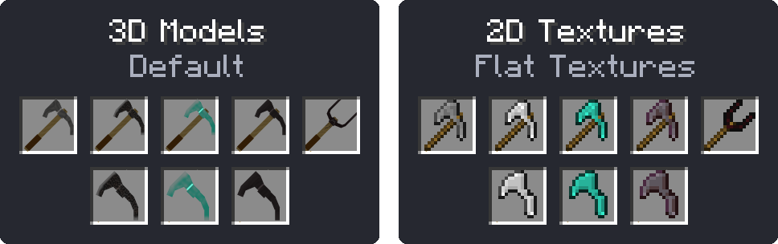

---
navigation:
  title: Controls and settings
  icon: minecraft:comparator
  parent: index.md
  position: 90
---

# Controls and settings

| Action | Key |
|---|---|
| Open the tool menu | <KeyBind id="key.megatools.open_gui" /> |
| Switch Enchantment Plate | <KeyBind id="key.megatools.switch_plate" /> |
| Swap to the pre-selected tool / back | <KeyBind id="key.megatools.swap_tool" /> |
| Swap to the last tool | <KeyBind id="key.megatools.swap_last" /> |
| Pick between pre-selected tools | Shift + mouse wheel |

Every switch in the tool menu also has its own key: *Toggle Strip*, *Toggle Break*, *Toggle Light* and so on.
They have no key by default; bind the ones you want under Options > Controls > Key Binds > Mega Tools. The key
only works while you hold a paxel or Mega Tool in either hand, and switches that ability on the held tool. The
message above the hotbar shows the new state.

Settings are in config/megatools-common.toml.

## Chat commands

These settings can also be changed in chat, without operator rights or cheats, also on a server. They
change your own config/megatools-common.toml right away. Type a command without a value to see the current setting.

| Command | What it changes |
|---|---|
| `/megatools animation true` or `false` | Mega Tool poke animation (`false`: the normal tool swing) |
| `/megatools delayed_break <1-200>` | Ticks between blocks while holding left click with Delayed Break on (20 ticks = 1 second) |
| `/megatools menu classic` or `compact` | Which tool menu opens |

Operators (or players with cheats enabled) can switch the held tool light for every player with
`/megatools held_light true` or `false`.

## 3D models or flat textures

By default, the tools and heads use 3D models. To use flat 2D textures instead, enable
**Mega Tools Flat Textures** under Options > Resource Packs. The pictures in this guide then show the flat
textures.

## Mega Tool animation

`megaToolAnimation` in `config/megatools-common.toml` picks how every Mega Tool moves while mining and attacking: **Poke** (the
tool turns forward and pokes the block) or **Vanilla** (the normal tool swing). It works with the 3D models
and with the flat textures.
