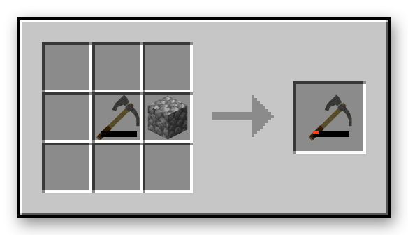
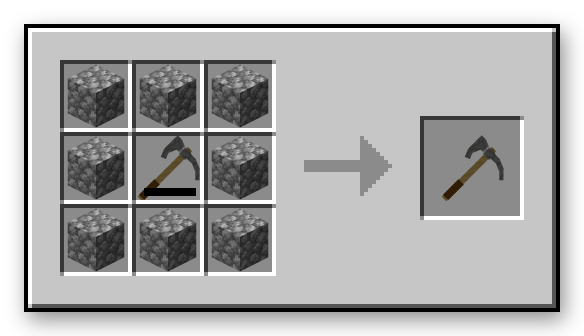
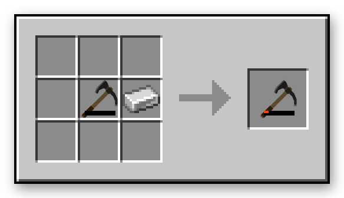
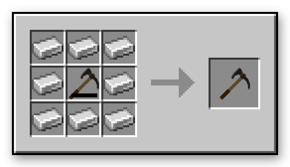
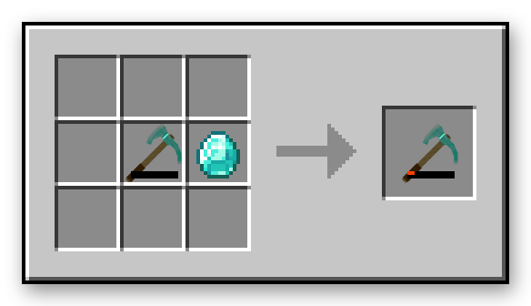

---
navigation:
  title: Durability and repair
  icon: minecraft:anvil
  parent: index.md
  position: 80
---

# Durability and repair

Paxels never break. At 1 durability they stop working until repaired, and nothing stored is lost.
8 resources of the tier will fully repair a tool, less resources are consumed with a tool that is not fully broken.

 

 

 
