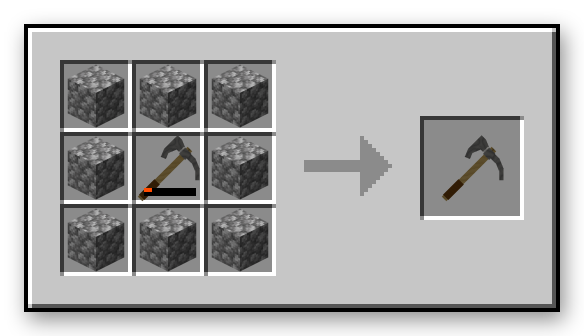
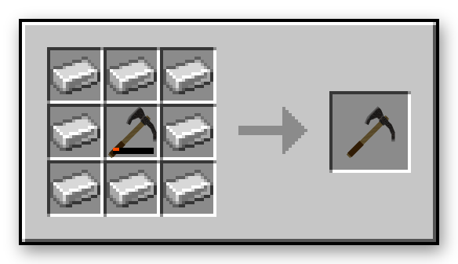
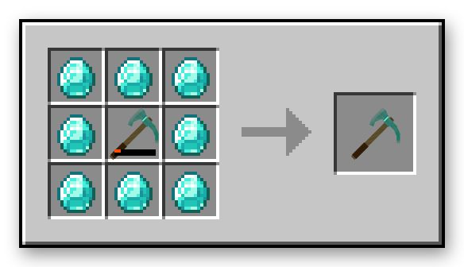

---
navigation:
  title: Durability and repair
  icon: minecraft:anvil
  parent: index.md
  position: 80
---

# Durability and repair

Paxels **never break**. At 1 durability a paxel stops working: no mining, fighting or abilities until it
is repaired. Its menu, storage and plates still work, so nothing is ever lost.

Surround a damaged paxel with its material to **fully repair** it. It keeps its name, storage, plates and
everything else. Repairing in an anvil with the same materials works too, as does Mending from a plate.

If a crafting recipe ever uses up one of these tools, everything stored in it is given back to you.
