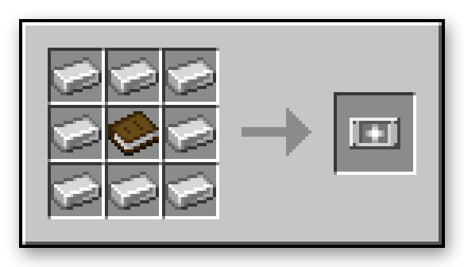

---
navigation:
  title: Enchantment Plates
  icon: megatools:enchantment_plate
  parent: index.md
  position: 50
item_ids:
- megatools:enchantment_plate
---

# Enchantment Plates

<ItemImage id="megatools:enchantment_plate" scale="2" />

The tools themselves can't be enchanted. You enchant **plates** instead, and the plate loaded in a tool
gives it its enchantments.

## Enchanting a plate

* **Enchanting table**: put in a blank plate, just like a book.
* **Anvil**: a plate on the left, an enchanted book on the right. Matching levels combine
  (Efficiency IV + IV = V).

Plates only accept enchantments for swords, pickaxes, axes, shovels, hoes, shears, brushes and flint and
steel. Enchantments that don't go together, such as Silk Touch and Fortune, can't be put on the same plate.

## Two plates per tool

Every tool holds a primary and a secondary plate. Press <KeyBind id="key.megatools.switch_plate" /> to
switch between them, for example from a Silk Touch plate to a Fortune plate. The message above the hotbar
shows which plate was loaded. Rename a plate in an anvil to see that name in the message.

If something removes an enchantment from your tool, such as a disenchanting machine from another mod,
the loaded plate loses it too.

## Crafting

