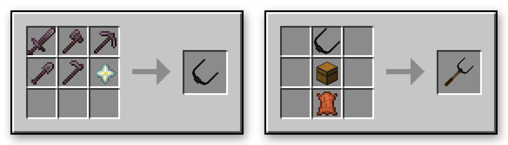

---
navigation:
  title: The Mega Tool
  icon: megatools:mega_tool
  parent: index.md
  position: 20
item_ids:
- megatools:mega_tool
- megatools:netherite_head
---

# The Mega Tool

<ItemImage id="megatools:mega_tool" scale="3" />

* **Instant mining**: breaks every block in one hit, and every block drops as if mined with the right
  tool. Unbreakable blocks such as bedrock stay unbreakable.
* **Delayed Break**: while you hold left click, the Mega Tool pauses briefly between blocks so you
  don't dig further than you meant to. Every new click still breaks a block immediately. Switch it off in
  the [tool menu](tool_menu.md) to break as fast as you can aim.
* **Never wears out**, and it doesn't burn in fire or lava.
* Attack damage 22, attack speed 3.0 and 27 slots of [tool storage](tool_storage.md).

## Crafting

The Netherite Head is shapeless: any arrangement works.

