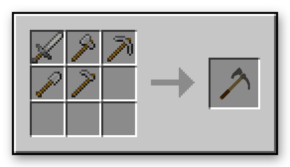

---
navigation:
  title: Paxels
  icon: megatools:iron_paxel
  parent: index.md
  position: 10
item_ids:
- megatools:stone_paxel
- megatools:iron_paxel
- megatools:diamond_paxel
- megatools:iron_head
- megatools:diamond_head
---

# Paxels

<Row>
  <ItemImage id="megatools:stone_paxel" scale="2" />
  <ItemImage id="megatools:iron_paxel" scale="2" />
  <ItemImage id="megatools:diamond_paxel" scale="2" />
</Row>

* Mines everything a pickaxe, axe, shovel and hoe can, 20% faster than a pickaxe of the same material.
* Cuts cobwebs and fights like a sword, with sweeping attacks.

| | Stone | Iron | Diamond |
|---|---|---|---|
| Attack damage | 10 | 14 | 18 |
| Attack speed | 1.6 | 2.0 | 2.5 |
| Durability | 655 | 1616 | 8171 |
| Tool storage | none | 9 slots | 18 slots |

## Right-click abilities

Each one is switched on or off in the [tool menu](tool_menu.md).

* **Place Torch**: places a torch from the torch slot. Off by default. When on, it comes before Strip,
  Path and Till.
* **Strip**: strips logs and wood, scrapes copper.
* **Path**: grass and dirt to paths. **Till**: grass and dirt to farmland (sneak to till first).
* **Shear, Brush, Ignite**: need a [Support Tool](support_tool.md).

## Break and Attack

* **Break** off: the tool breaks no blocks.
* **Attack** off: the tool doesn't hurt mobs or players.

## Crafting

