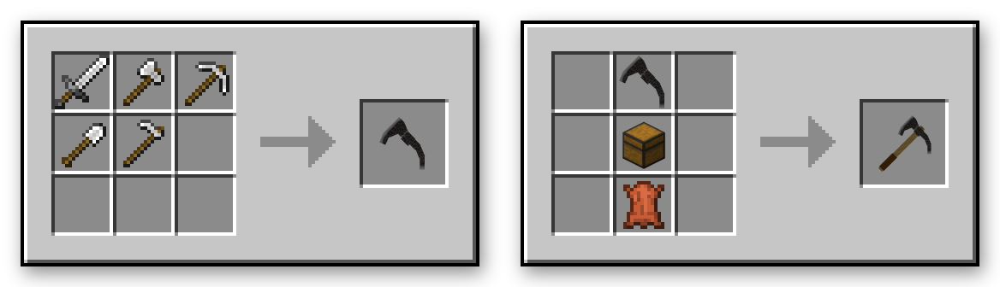
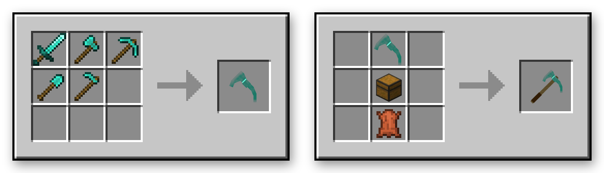

---
navigation:
  title: Paxels
  icon: megatools:iron_paxel
  parent: index.md
  position: 10
item_ids:
- megatools:stone_paxel
- megatools:iron_paxel
- megatools:diamond_paxel
- megatools:iron_head
- megatools:diamond_head
---

# Paxels

<Row>
  <ItemImage id="megatools:stone_paxel" scale="2" />
  <ItemImage id="megatools:iron_paxel" scale="2" />
  <ItemImage id="megatools:diamond_paxel" scale="2" />
</Row>

A paxel mines everything a pickaxe, axe, shovel and hoe can mine, and cuts cobwebs like a sword. It mines
20% faster than a vanilla pickaxe of the same material. Blocks that need a better tier still drop nothing.
In a fight it hits like a sword, including sweeping attacks.

| | Stone | Iron | Diamond |
|---|---|---|---|
| Attack damage | 10 | 14 | 18 |
| Attack speed | 1.6 | 2.0 | 2.5 |
| Durability | 655 | 1616 | 8171 |
| Tool storage | none | 9 slots | 18 slots |

## Right-click abilities

Each one can be switched on or off in the [tool menu](tool_menu.md).

* **Strip**: strips logs and wood, scrapes and removes wax from copper.
* **Path**: turns grass and dirt into paths, puts out campfires.
* **Till**: turns grass and dirt into farmland. Sneak while right-clicking to till instead of making a path.
* **Place Torch**: places a torch from the torch slot. Off by default.
* **Shear, Brush, Ignite**: need a [Support Tool](support_tool.md).

If more than one ability fits a block, the first one in this list is used.

## Crafting

The heads and the stone paxel are shapeless: any arrangement works. Each head is shown next to the
paxel it makes.

The Netherite Head and the Mega Tool are on the [Mega Tool](mega_tool.md) page.
