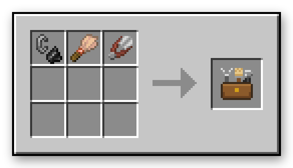

---
navigation:
  title: Support Tool
  icon: megatools:support_tool
  parent: index.md
  position: 40
item_ids:
- megatools:support_tool
---

# Support Tool

<ItemImage id="megatools:support_tool" scale="2" />

Put a Support Tool in a tool's **Support Tool slot** (in the [tool menu](tool_menu.md)). The tool then
gains three abilities, each with its own button:

* **Shear**: shear sheep, mooshrooms and snow golems; collect leaves and vines; trim cave vines, kelp and
  weeping or twisting vines so they stop growing. Leaves and wool also mine at shears speed.
* **Brush**: hold right click on suspicious sand or gravel.
* **Ignite**: light fires and nether portals, campfires, candles and TNT.

Taking the Support Tool out removes the abilities again. It works in every paxel and in the Mega Tool.

## Crafting

Shapeless: any arrangement works.

