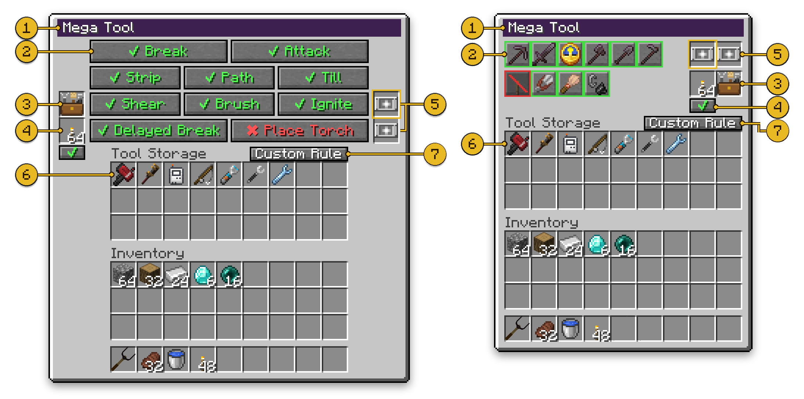

---
navigation:
  title: The tool menu
  icon: megatools:diamond_paxel
  parent: index.md
  position: 30
---

# The tool menu

Hold a tool and press <KeyBind id="key.megatools.open_gui" />.

There are two menu styles, **Classic** (left) and **Compact** (right). Both do the same, and each number marks
the same part in both menus.

1. **Name**: click to rename the tool.
2. **Ability buttons**: green = on, red = off.
3. **Support Tool slot**: unlocks Shear, Brush and Ignite.
4. **Torch slot** (up to 64). The button below it switches the light on or off.
5. **Enchantment Plates**: primary and secondary. Gold frame = loaded plate.
6. **Tool storage**: hover a tool and press <KeyBind id="key.megatools.swap_tool" /> to swap to it.
7. **Custom Rule**: choose which blocks pre-select which stored tool.

## Classic or Compact

The first time you open a menu you pick a style. Change it later with menuStyle in config/megatools-common.toml.
