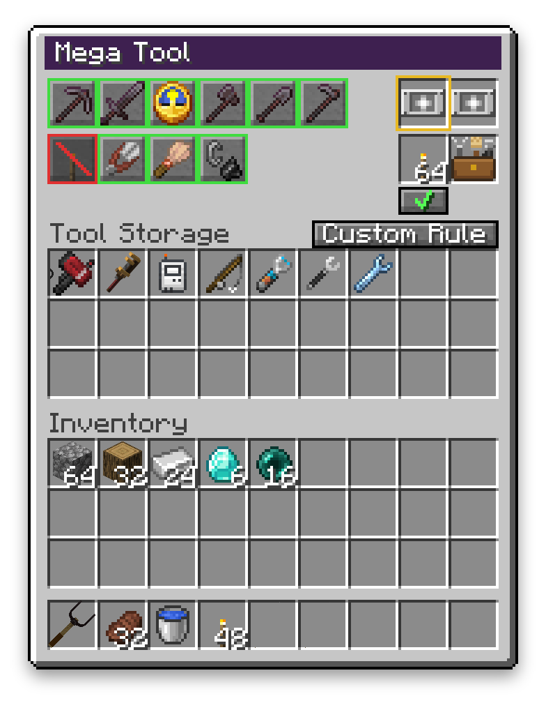

---
navigation:
  title: The tool menu
  icon: megatools:diamond_paxel
  parent: index.md
  position: 30
---

# The tool menu

Hold a paxel or the Mega Tool and press <KeyBind id="key.megatools.open_gui" />.

1. **Name**: click it to rename the tool, then press Enter.
2. **Ability buttons**: green ✔ = on, red ✖ = off. Row 1: Break and Attack, which switch
   block breaking and attacking off for this tool (see [Paxels](paxels.md#break-and-attack)). Row 2:
   Strip, Path, Till. Row 3: Shear, Brush, Ignite (only shown while a
   [Support Tool](support_tool.md) is in its slot). Last row: Delayed Break (Mega Tool only) and Place
   Torch.
3. **Support Tool slot**: unlocks Shear, Brush and Ignite.
4. **Torch slot** (up to 256 torches). The small button below it switches the
   [light](torches_and_light.md) on or off.
5. **Enchantment Plates**: primary (top) and secondary (bottom). The gold frame marks the loaded plate.
   See [Enchantment Plates](enchantment_plates.md).
6. **Tool storage**: hover a stored tool and press <KeyBind id="key.megatools.swap_tool" /> to close the
   menu and swap straight to it.
7. **Custom Rule**: opens the [Custom Rules menu](tool_storage.md#custom-rules) of this tool, where you
   choose which blocks pre-select which stored tool. Only on tools with tool storage.

## Classic or Compact

The menu comes in two styles that do exactly the same. The first time you open a tool menu you are
shown both and pick one:

* **Classic** (above): a wide menu, every button with its name on it.
* **Compact**: as wide as a chest, every button an item icon. A green frame means on; a red frame with
  the icon dimmed and struck through means off. Hover a button to read its name and what it does.
  Shear, Brush and Ignite are greyed out until a Support Tool is in its slot.

First row: Break, Attack, Delayed Break (Mega Tool only), Strip, Path, Till. Second row: Place Torch,
Shear, Brush, Ignite. The four slots on the right are the two Enchantment Plates (top), the torch slot
with its light button (bottom left) and the Support Tool slot (bottom right).

Your choice is saved for your game. Change it at any time under Mods > Mega Tools > Config > Tool menu
style ("Ask next time" shows both menus again).

Shift-clicking an item in your inventory moves it to the right slot automatically. The tool stays in your
hotbar while the menu is open, and its slot is locked.
