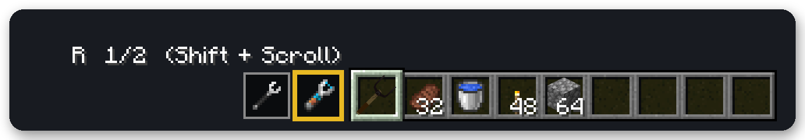
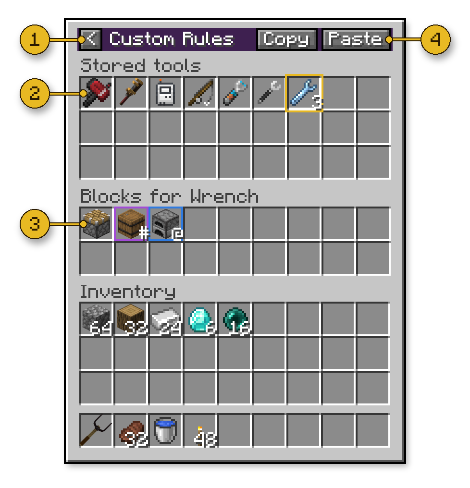

---
navigation:
  title: Tool storage and auto-swap
  icon: minecraft:chest
  parent: index.md
  position: 70
---

# Tool storage and auto-swap

The Iron Paxel, Diamond Paxel and Mega Tool can store **9, 18 and 27** other tools: wrenches, shears,
screwdrivers, crowbars, configurators, building gadgets, construction sticks and more. Each slot holds one
tool. Only items known to be tools are accepted, so the storage can't be used as a backpack. Paxels, the
Mega Tool and Enchantment Plates can never be stored.

An item is accepted if it is in the item tag c:tools/wrench or megatools:storable_item, or listed in the
file config/megatools-storage-whitelist.json. Modpacks can add more tools there, see
[For modpack developers](modpack_developers.md).

## Auto-swap

1. Look at a block from another mod. Stored tools from the **same mod** are pre-selected and shown next
   to your hotbar.
2. Press <KeyBind id="key.megatools.swap_tool" /> to swap the paxel for the selected tool. Your paxel is
   kept safely inside it.
3. Press <KeyBind id="key.megatools.swap_tool" /> again to swap back. The tool returns to its storage slot.

## Swap to the last tool

Press <KeyBind id="key.megatools.swap_last" /> to swap to the tool you swapped to last time, no matter
what block you are looking at. Press <KeyBind id="key.megatools.swap_tool" /> or
<KeyBind id="key.megatools.swap_last" /> to swap back to your paxel. If the tool was moved to another storage slot it is still found.

## Custom rules

Auto-swap only knows that a tool belongs to the blocks of its own mod. Custom rules let you decide
yourself which stored tool is pre-selected for which block: a wrench for every chest, shears for leaves,
a Flint and Steel for one special block. They also work on vanilla blocks.

Open the [tool menu](tool_menu.md) and click **Custom Rule** above the tool storage.

1. **Back**: returns to the tool menu.
2. **Stored tools**: one cell for every kind of tool in the tool storage. Click a tool to select it (gold
   frame). The small number is how many filters it has.
3. **Filters** of the selected tool: up to 18 blocks.
4. **Copy** and **Paste**: move all rules from one paxel or Mega Tool to another.

### Setting up a rule

1. Select the stored tool the rule is for.
2. Give it a block: pick the block up from your inventory and click a filter slot, Shift-click the block
   in your inventory, or drag it from JEI or EMI onto a filter slot. Nothing is used up: the slot only
   remembers the block.
3. Choose what the filter matches. Left-click a filled slot to go to the next option:

| Option | Matches | Shown as |
|---|---|---|
| This block | only that block | plain slot |
| Tag | every block that has the chosen block tag | purple frame and **#** |
| Whole mod | every block from the block's mod | blue frame and **@** |

On a tag filter, scroll over the slot to pick which of the block's tags is used. The tooltip lists all of
them and marks the chosen one. Right-click a filter to remove it.

In the picture, the wrench is pre-selected for pistons (this block), for every barrel (tag) and for every
block from the furnace's mod (whole mod).

### Using the rules

Close the menu and look at a matching block with the tool in your hand. The stored tool appears next to
your hotbar: press <KeyBind id="key.megatools.swap_tool" /> to swap to it.

If several tools match a block, they are offered in this order, and **Shift + scroll** picks between
them: filters for exactly this block, tag filters, whole-mod filters, and last the automatic same-mod
tools.

### Copying rules to another tool

Custom rules belong to **one** paxel or Mega Tool. To bring them over, click **Copy**, open the Custom
Rules menu of the other tool and click **Paste**. Paste replaces all rules of that tool. A default
rule you removed on the first tool is not added again on the second. Rules name the
stored tool by its kind, so they work as soon as the same kind of tool is in the other tool's storage,
in any slot.

### Good to know

* A tool that has filters but is no longer in the tool storage is shown faded. Its filters are kept and
  work again when the tool is put back.
* Some filters are added for you: the default rules (see
  [For modpack developers](modpack_developers.md)). They appear the first time the tool they belong to
  is put in the tool storage. They are normal filters: change or remove them as you like. A default
  rule you removed does not come back on that tool.
* Some blocks have no item of their own (some cables and multiblock parts). Use a tag or whole-mod
  filter for those.

## More about auto-swap

If several stored tools match, **Shift + scroll** picks between them. Vanilla blocks never pre-select a
tool on their own, because the paxel already handles them. If a swapped-out tool breaks, your paxel is given back to
you automatically.

A stored tool is normally pre-selected only for blocks from its own mod. To use it on other mods' blocks
too, list it in the file config/megatools-tool-aliases.json. It already links common mod families, such
as Applied Energistics 2 and its addons, or Create and its addons. The file is re-read whenever you join
a world. See [For modpack developers](modpack_developers.md).
